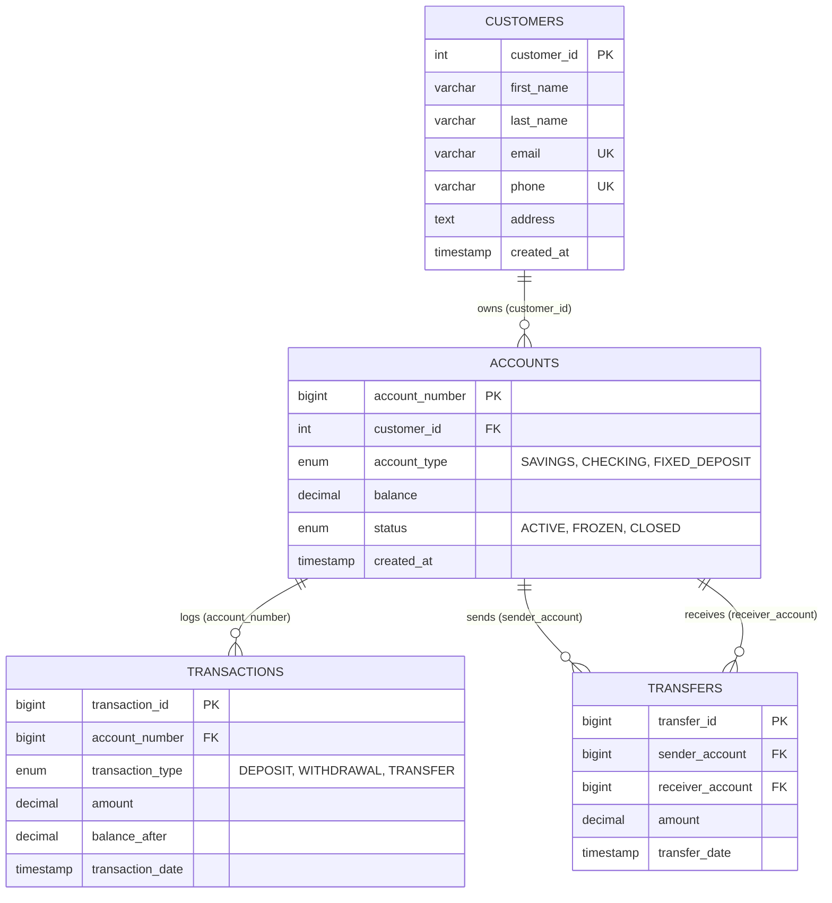

# 🏦 Aura Bank Management System (DBMS Project)

A complete, modern **Bank Management System** developed with **MySQL**, **Node.js / Express**, and a sleek **Glassmorphic Web Interface**.

Designed according to the MySQL relational EER Diagram featuring automated ledger auditing using **MySQL Triggers** and **ACID-compliant transactions**.

---

## 🚀 Live Localhost Link

- **Web Dashboard:** [http://localhost:5000](http://localhost:5000)
- **API Health Check:** [http://localhost:5000/api/health](http://localhost:5000/api/health)
- **Database Status:** `Connected (BankManagementDB on 127.0.0.1:3306)`

---

## 📌 Architecture & Relational Database Design

The database schema matches the **EER Diagram** with 4 interconnected tables and automated database triggers:



### ⚡ Automated Database Trigger: `after_account_update`

To enforce financial data integrity, whenever an account balance changes (via direct deposit, withdrawal, or fund transfer), MySQL automatically executes this trigger to write an immutable audit trail into `Transactions`:

```sql
DELIMITER $$
CREATE TRIGGER after_account_update
AFTER UPDATE ON Accounts
FOR EACH ROW
BEGIN
    IF NEW.balance <> OLD.balance THEN
        INSERT INTO Transactions (account_number, transaction_type, amount, balance_after)
        VALUES (
            NEW.account_number, 
            IF(NEW.balance > OLD.balance, 'DEPOSIT', 'WITHDRAWAL'), 
            ABS(NEW.balance - OLD.balance), 
            NEW.balance
        );
    END IF;
END$$
DELIMITER ;
```

---

## 💻 Tech Stack

- **Database:** MySQL 8.0 with connection pooling (`mysql2/promise`)
- **Backend:** Node.js & Express
- **Frontend:** Vanilla HTML5, Vanilla CSS3 (modern glassmorphism, responsive design, custom palettes), Vanilla JavaScript (ES6 Modules)
- **Icons & Fonts:** FontAwesome 6, Google Fonts ('Plus Jakarta Sans', 'JetBrains Mono')

---

## 📂 Project Structure

```
DBMS project/
├── .env                         # Database credentials & server port
├── .env.example                 # Example config template
├── package.json                 # Project dependencies & scripts
├── server.js                    # Express application entrypoint
├── Database.sql                 # Complete SQL DDL, DML, triggers & sample data
├── EER diagram.png              # Database EER Diagram
├── src/
│   ├── config/
│   │   └── db.js                # MySQL connection pool & health checker
│   ├── controllers/
│   │   ├── customerController.js
│   │   ├── accountController.js
│   │   ├── transactionController.js
│   │   └── dashboardController.js
│   └── routes/
│       ├── customerRoutes.js
│       ├── accountRoutes.js
│       ├── transactionRoutes.js
│       └── dashboardRoutes.js
└── public/
    ├── index.html               # Main banking dashboard & console
    ├── css/
    │   └── style.css            # Custom glassmorphic design system
    ├── js/
    │   ├── api.js               # Frontend API client
    │   └── app.js               # Application logic & dynamic UI controller
    └── images/
        └── eer-diagram.png      # EER diagram asset
```

---

## 🛠️ How to Run & Connect

### 1. Database Configuration (`.env`)
The database connection settings are stored in `.env`:
```env
PORT=5000
DB_HOST=127.0.0.1
DB_PORT=3306
DB_USER=root
DB_PASSWORD=YourPasswordHere
DB_NAME=BankManagementDB
```

### 2. Install Dependencies
```bash
npm install
```

### 3. Start the Server
```bash
npm start
```
The server will boot up, verify connection to MySQL, and display:
```
=======================================================
🏦 BANK MANAGEMENT SYSTEM SERVER RUNNING
🌐 Localhost Link: http://localhost:5000
📡 API Base URL:   http://localhost:5000/api
=======================================================
✅ Connected to MySQL DB: [BankManagementDB] on 127.0.0.1:3306
📊 Tables verified (4): accounts, customers, transactions, transfers
```

Open your browser at **[http://localhost:5000](http://localhost:5000)**.

---

## 🌟 Key Features

1. **Executive Dashboard:** Live metrics for total liquidity, active vs. frozen accounts, customer registrations, and real-time transaction streams.
2. **Customer Management:** Create and search customers, view full customer profiles with all associated bank accounts.
3. **Account Portfolio:** Manage Savings, Checking, and Fixed Deposit accounts with status controls (Freeze / Unfreeze / Close).
4. **Deposit & Withdrawal:** Instant balance updates with automated trigger logging.
5. **ACID Inter-Account Transfers:** Atomic database transactions that debit sender, credit receiver, record the transfer, and maintain data consistency.
6. **Database Connection Inspector:** Real-time DB connection tester displaying ping latency, database version, and live status.
